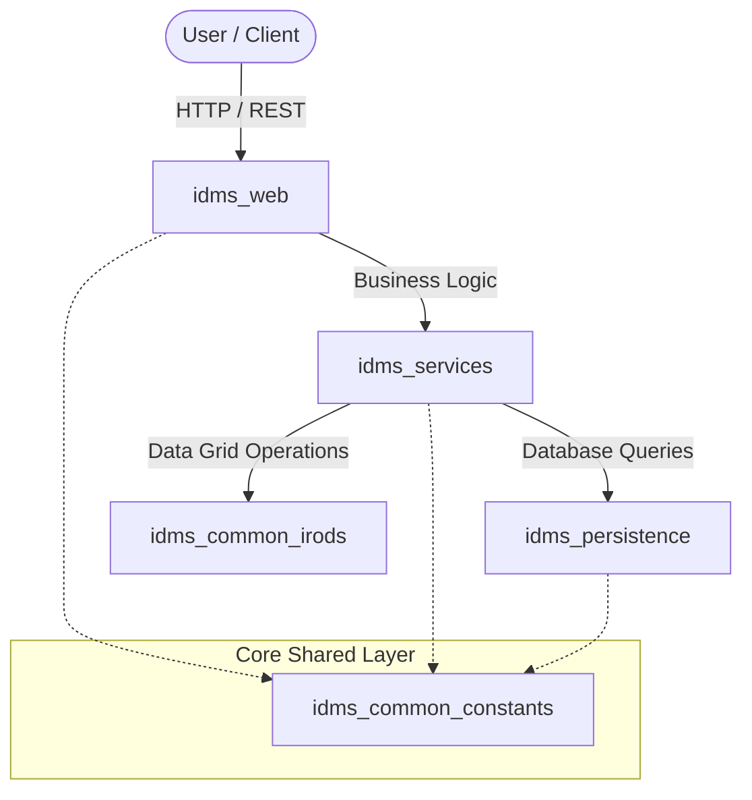

# Welcome to iDMS

Welcome to the official documentation hub for the **integrated Data Management System (iDMS)** suite. 

iDMS is a modular, scalable data management architecture designed to streamline data processing, storage, and web-based interaction across secure institutional infrastructure.

---

## The iDMS Ecosystem

The system is decoupled into five dedicated, version-controlled Python packages (licensed under the **EUPL 1.2**):

*   **`idms_common_constants`**: Shared configuration schemas, error codes, and global constants.
*   **`idms_common_irods`**: Robust wrappers and utilities for iRODS data grid interactions.
*   **`idms_persistence`**: Data models and database persistence layers.
*   **`idms_services`**: Core backend business logic and application services.
*   **`idms_web`**: User-facing web application interface and API endpoints.

---

## System Architecture at a Glance

The high-level data flow between the user interface, core services, and storage backends is structured as follows:

